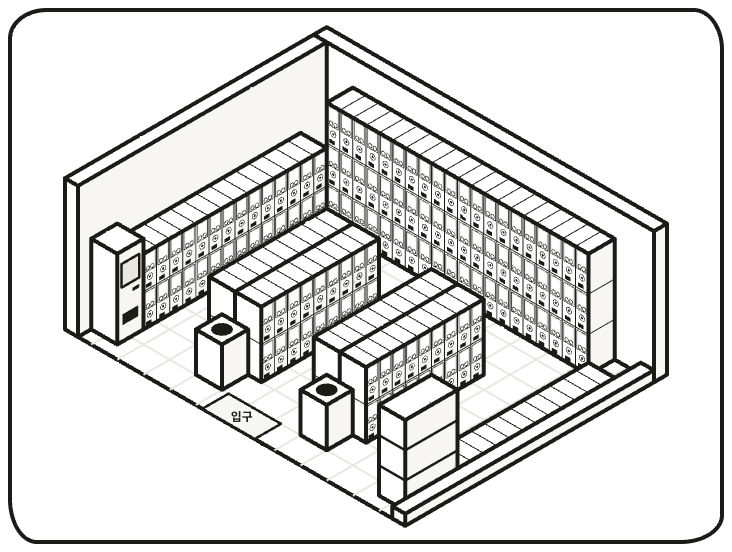
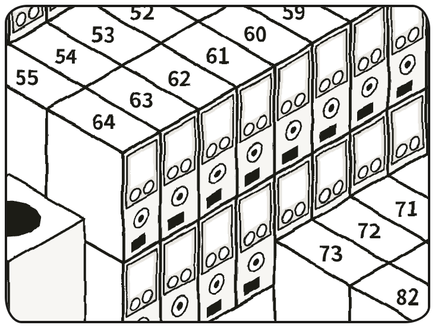
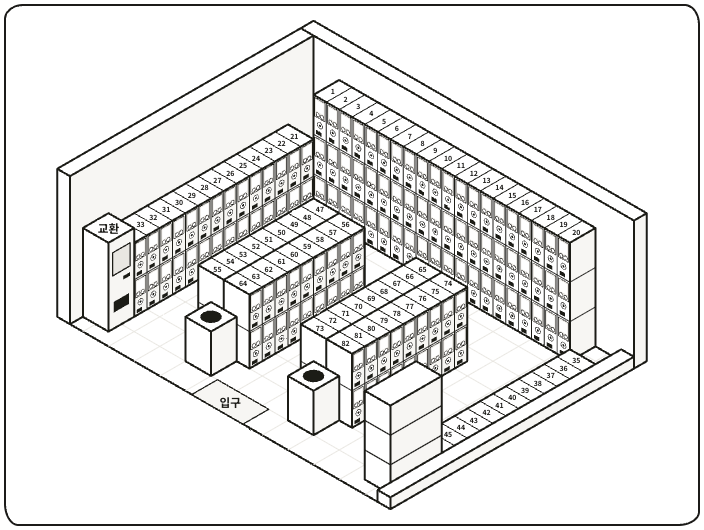

# 0009. 내부 지도는 여기서 멈추고, 그림은 "나만의 가챠샵"에 다시 쓴다

날짜: 2026-11-26 / 상태: 내부 지도 넓히기 보류(#240). "나만의 가챠샵"은 방향만 있고 정해지지 않음(#239)

다음에 이 일을 다시 정할 때 읽는 문서다. 정한 것은 "미룬다" 하나이고, 나머지는 그때 쓸 사실을 모아 둔 것이다. 내부 지도의 방식과 데이터 원칙은 [0004](0004-map-and-indoor-map.md)에 그대로 있다.

## 결정

- **가챠샵(굿즈샵) 내부 지도를 더 만드는 일을 미룬다.** 기계 종류 카탈로그(#163), 가챠샵 만들기 편집기(#164), 실제 매장의 내부 지도(#109)를 멈춘다.
- **이미 만든 것은 그대로 둔다.** 코드와 데이터를 지우지 않았고, 운영의 내부 지도와 물건의 "뽑은 곳" 고르기도 지금 그대로다.
- **그림은 다른 곳에 다시 쓴다(방향).** 가챠 기계와 매장의 손그림 입체 그림을 "나만의 가챠샵"이라는 느낌으로, 내 업적 등을 꾸미는 데 쓴다. 무엇을 어떻게 보여 줄지는 정하지 않았다(#239).
- 미루는 것은 내부 지도뿐이다. 바깥 지도와 실제 가챠샵 목록(#192, #196)은 이 결정에 들어 있지 않다.

## 미룬 까닭

실제 가챠샵의 크기·비율·구조로 다시 그린 내부 지도(#188, #189)가 2026-11-26에 `main`에 들어갔다. 그 뒤 같은 날 이렇게 판단했다.

> 지금 모바일이나 태블릿으로 보기에는 너무 불편하고, 크게 쓰는 것에 의미가 없어 보인다.

- 앞의 말은 아래 "써 보고 알게 된 것"의 잰 값과 맞는다. 실제 비율을 지키면 기기가 화면에서 너무 작아진다.
- 뒤의 말은 "내부 지도를 앱에서 크게 키워 갈 까닭이 없다"로 읽고 정리했다. 이것은 정리한 쪽의 풀이다.

## 지금까지 한 것

머지한 날은 한국 시간이다.

| 머지한 날 | 한 것 | 이슈 · PR |
|---|---|---|
| 2026-11-21 | 방식 결정([0004](0004-map-and-indoor-map.md)): 바깥은 네이버 지도, 안은 2D 격자 데이터 + SVG 등각 그림 | #108 · PR #133 |
| 2026-11-21 | 데이터 형식(굿즈샵 / 매장 구조 / 기기 내용 / 시리즈)과 가상 굿즈샵 | #109의 일부 · PR #134 |
| 2026-11-21 | 내부 입체 지도 화면 | #110 · PR #138 |
| 2026-11-21 | 기기를 누르면 들어 있는 시리즈 보기 | #111 · PR #140 |
| 2026-11-21 | 굿즈샵 지도 화면(네이버 지도) | #112 · PR #141 |
| 2026-11-21 | 물건의 "뽑은 곳"(굿즈샵 → 기기 → 단) 기록과 보기 | #142 · PR #143 |
| 2026-11-23 | 하단 메뉴에 '지도' | #159 · PR #172 |
| 2026-11-26 | 격자 한 칸을 50cm에서 25cm로 | #188 · PR #190 |
| 2026-11-26 | 실제 크기·비율·구조로 다시 그리기, 가상 굿즈샵 구조 v2 | #189 · PR #191 |
| 2026-11-26 | 실제 가챠샵 5곳(홍대·영등포)을 내부 지도 없이 싣기 | #192의 일부 · PR #197 |
| 2026-11-26 | 내부 지도 넓히기를 미룸 | #240 · 이 문서 |

## 지금 main에 있는 것

**화면**

- 하단 메뉴 '지도'(`/shops`) → 굿즈샵 목록 → 내부 지도(`/shops/view?id=…`). 내부 지도가 있는 곳은 지어낸 "네모 가상 굿즈샵 (예시)" 하나다. 실제 가챠샵 5곳은 "내부 지도 준비 중"으로 보인다.
- 물건 등록·수정의 "뽑은 곳" 고르기: 굿즈샵 → 지도에서 기기 → 단. 내부 지도와 같은 그림을 쓴다. 내부 지도가 있는 굿즈샵만 고를 수 있다.

**그림** (2026-11-26, 헤드리스 Chrome)

| 휴대폰(390×844)에서 처음 보이는 1층 | 기기를 한 번 눌러 커진 모습 |
|---|---|
|  |  |

태블릿(820×1180)에서 처음 보이는 1층:

**코드** (모두 남아 있다)

| 파일 | 하는 일 |
|---|---|
| `src/lib/iso.ts` | 등각 투영, 네 방향 돌리기, 그리는 순서, 면 위의 점. 다른 코드에 기대지 않는 순수 함수다 |
| `src/lib/shops/schema.ts` | 매장 구조·기기 내용·시리즈의 형식과 검사(zod). 격자 `cellCm` 25·50, 집기 6종(벽·기둥·계산대·진열대·교환기·수거함) |
| `src/lib/shops/banks.ts`, `contents.ts` | 나란히 붙은 기기를 줄로 묶기, 줄 단위로 번호 매기기 |
| `src/components/shop/IsoFloor.tsx` | 한 층의 그림. 가챠 기계 얼굴, 교환기, 수거함, 진열대, 계산대, 벽 |
| `src/components/shop/FloorCanvas.tsx` | 끌기, 두 손가락 확대, 돌리기, 작게 보이는 기기를 누르면 먼저 커지는 조작 |
| `src/components/shop/FloorMap.tsx`, `OriginPicker.tsx`, `MachineDialog.tsx`, `MachineList.tsx` | 내부 지도 화면과 "뽑은 곳" 고르기 |

**데이터** `public/shops/`

- `layouts/nemo-virtual/v2.json`: 가상 굿즈샵. 1층 6.5m×5m에 기기 자리 82곳(184대), 2층 4.5m×4m에 39곳(90대). ㎡당 5.7대와 5.0대로, 0004에 적은 실제 전문점의 범위(4.4~6.2대) 안이다. 처음 낸 `v1.json`(50cm 격자)도 남아 있다.
- `machines/nemo-virtual.json`, `series.json`: 기기 내용 250칸과 예시 시리즈 16종. 모두 지어낸 이름이다.
- 실제 기계 치수와 출처는 0004의 "격자 한 칸을 25cm로 바꾼 까닭"에, 구조를 참고한 매장 사진은 PR #191에 있다.

## 써 보고 알게 된 것

**실제 비율로 그리면 기기가 화면에서 너무 작다.** 2026-11-26에 `main`(fa61338)을 로컬에서 띄우고 헤드리스 Chrome의 화면 크기를 바꿔 가며 쟀다. 실제 휴대폰·태블릿에서 잰 값은 아니다.

| 화면 | 지도 상자 | 기기 앞면 폭 (1층 / 2층) | 기기 번호 | 기기를 처음 누르면 |
|---|---|---|---|---|
| 휴대폰 360×800 | 328×246px | 6.0px / 7.2px | 안 보임 | 누른 곳이 커짐 |
| 휴대폰 390×844 | 358×269px | 6.5px / 7.9px | 안 보임 | 누른 곳이 커짐 |
| 휴대폰 430×932 | 398×299px | 7.3px / 8.8px | 안 보임 | 누른 곳이 커짐 |
| 태블릿 세로 744×1133 | 620×465px | 11.4px / 13.8px | 보임 | 누른 곳이 커짐 |
| 태블릿 세로 820×1180 | 696×522px | 12.8px / 15.5px | 보임 | 누른 곳이 커짐 |
| 태블릿 가로 1180×820 | 736×552px | 13.6px / 16.4px | 보임 | 누른 곳이 커짐 |

- 잰 모든 화면에서 기기 앞면이 18px에 못 미친다. 18px은 `FloorCanvas`가 "누르면 바로 고른다"고 보는 기준이다. 그래서 휴대폰이든 태블릿이든 한 번 눌러 키운 뒤 다시 눌러야 기기 내용이 열린다.
- 지도 상자는 가로:세로가 4:3으로 고정이다. 화면이 커도 높이를 다 쓰지 못한다(820×1180 화면에서 상자 높이 522px). 잰 화면 모두에서 그림은 세로가 먼저 찼다. 1층에서는 높이 2.5m인 벽이 그림 높이의 30%쯤을 차지한다.
- 그림 한 장의 SVG 요소는 1층 1,884개, 2층 972개다.

**가게가 작으면 바로 누를 수 있다.** 같은 그림 방식으로, 2단 기기가 벽 없이 한 줄로 선 작은 구조를 임시로 그려 쟀다(저장소에는 넣지 않았다).

| 임시 구조 | 휴대폰 390×844 | 태블릿 820×1180 |
|---|---|---|
| 가로 1.5m × 세로 0.75m, 기기 6대 한 줄 | 19.9px, 바로 열림 | 39.0px, 바로 열림 |
| 가로 2m × 세로 0.75m, 기기 8대 한 줄 | 18.3px, 바로 열림 | 35.9px, 바로 열림 |
| 가로 3m × 세로 1m, 기기 12대 한 줄 | 15.3px, 먼저 커짐 | 29.9px, 바로 열림 |
| 가로 3m × 세로 2m, 기기 12대 한 줄 | 13.5px, 먼저 커짐 | 26.4px, 바로 열림 |

- 지금 그림 방식과 4:3 상자로는, 휴대폰에서 기기 6~8대가 선 한 줄 정도까지만 바로 누를 수 있다. 그때도 앞면은 18~20px이다.
- 등각 그림은 화면의 가로를 공간의 가로와 세로가 나눠 쓰고, 화면의 세로에는 물건의 높이까지 더해진다. 공간이 넓어지는 만큼 기기는 작아진다.

**그리면서 알게 된 것** (PR #191)

- 폭 25cm 기기 80대에 굵은 선을 두르면 까맣게 뭉개진다. 나란한 기기를 줄로 묶어 줄에만 굵은 테두리를 두르고, 기기 사이에는 가는 선을 그었다.
- 보는 사람 쪽 벽에 등을 댄 기기 줄은 벽과 함께 낮춰 그려야 안이 보인다. 그 줄의 앞면은 지도를 돌려야 보인다.
- 번호 글자는 6px보다 작아지면 숨긴다. 휴대폰에서 매장 전체를 볼 때는 번호가 보이지 않는다.

**확인하지 못한 것**

- 실제 휴대폰·태블릿에서의 두 손가락 확대, 끌기, 그리는 속도
- 한국 매장의 구조(참고한 사진은 일본·호주 매장이다), 3단 기계의 높이(200cm로 가늠했다), 통로 폭(1m로 가늠했다)

## 다시 쓸 수 있는 것

"나만의 가챠샵"을 만들 때 그대로, 또는 꺼내서 쓸 수 있다.

- **그리는 함수** `src/lib/iso.ts`: 내부 지도에 묶여 있지 않다. 상자와 방향만 받는다.
- **가챠 기계와 집기의 그림**: `IsoFloor.tsx` 안의 `MachineFace`(통, 상품 카드, 캡슐, 손잡이, 나오는 곳), `SlotBox`, `ChangerFace`, `FixtureBox`. 지금은 파일 밖으로 내보내지 않아서, 다른 화면에서 쓰려면 먼저 꺼내야 한다.
- **조작** `FloorCanvas.tsx`: 층 하나와 기기 목록을 받아 끌기·확대·돌리기를 맡는다.
- **형식과 검사** `src/lib/shops/schema.ts`: 격자 위에 상자를 놓는 형식, 겹침과 바닥 밖 검사. 사용자가 가게를 꾸미게 한다면 같은 형식을 쓸 수 있다.
- **표준 기계의 크기**: 2단 기계를 폭 25cm × 깊이 50cm × 높이 125cm로 적는다(0004).

## 다음에 정할 것

"나만의 가챠샵"(#239)을 시작하기 전에 정한다.

1. **무엇을 보여 주는가.** 업적을 얻으면 가게에 무엇이 생기는지(기계 한 대, 집기, 가게 크기), 업적 말고 무엇을 담는지(포인트·레벨, 카테고리별 등급, 모은 시리즈, 가 본 가챠샵). 업적 초안은 10개다([0006](0006-points-and-achievements.md)). 카테고리별 등급은 #179의 2026-11-25 댓글에 있다.
2. **사용자가 배치를 고치는가.** 업적에 따라 저절로 채워지는 그림인지, 사용자가 직접 놓는지. 직접 놓게 하면 기기에 저장할 것이 생긴다(위험 영역: Dexie 새 버전과 백업).
3. **어디에 두는가.** 0006은 포인트·업적이 보이는 곳을 마이로 정했다(#183). 그 안인지, 꾸미기(#207) 옆인지, 따로인지.
4. **꾸미기와 맞추기.** 꾸미기(#207, #208)는 정면에서 본 2D로 그리고 입체와 등각 투영은 하지 않는다고 적어 두었다. "나만의 가챠샵"은 등각 그림을 쓰므로, 꾸미기 결정 기록(#208)을 쓸 때 함께 정한다. #208은 가방·장식장 모양을 업적으로 여는 것도 나중에 볼 것으로 적어 두었다.
5. **크기.** 위 표대로 휴대폰에서는 기기 6~8대 한 줄 정도만 바로 누를 수 있다. 가게를 그만큼 작게 잡을지, 실제 비율을 버리고 기기를 크게 그릴지, 지도 상자를 세로로 길게 할지, 지금처럼 키워서 볼지.
6. **캐릭터.** 네모의 입체 보기는 정면 그림에 윗면과 옆면을 덧붙인 것이고([0008](0008-character.md)), 내부 지도는 등각 투영이다. 네모를 가게 안에 세울지, 세운다면 두 그림을 어떻게 맞출지.
7. **기계에 넣는 그림.** 기계 앞면의 상품 카드에 무엇을 그릴지. 시리즈 이미지는 이용 허락을 확인하지 못했다(0004 "확인이 남은 것"). 내가 찍은 사진을 쓰면 꾸미기의 조각 오려내기(#211)와 겹친다.
8. **지금의 내부 지도.** 운영에 그대로 둘지, 들어가는 곳을 줄일지, 뺄지. 이번에는 그대로 두었다. 가상 굿즈샵이 실제 가챠샵 5곳과 같은 목록에 보이는 것도 남아 있다(#192).
9. **실제 가챠샵을 "뽑은 곳"으로 적기.** 지금 형식은 기기 자리까지 있어야 적을 수 있다(`ProductOrigin`의 `slotId`). 내부 지도를 미루는 동안 실제 가챠샵 5곳은 "뽑은 곳"으로 고를 수 없다. 0006의 "뽑은 곳을 적은 물건"과 "처음 기록한 가챠샵" 포인트, 근처 굿즈샵 자동 기록(#169), 가 본 가챠샵 표시(#162)가 여기에 걸려 있다. 굿즈샵만 적게 하려면 저장 형식을 건드린다(위험 영역).
10. **멈춘 이슈.** 아래 이슈를 다시 진행할지, 닫을지, "나만의 가챠샵"에 맞게 고쳐 쓸지.

## 멈춘 이슈

닫지 않고 보류라고 적어 두었다.

| 이슈 | 멈춘 것 |
|---|---|
| #163 가챠 기계 카탈로그와 종류별 모양 | 전부 |
| #164 가챠샵 만들기 편집기 | 전부 |
| #109 굿즈샵 데이터 형식과 첫 굿즈샵 | 남아 있던 일인 실제 매장 1곳의 내부 지도. 형식은 이미 들어갔다 |
| #106, #158 (묶음 이슈) | 위 세 이슈. #160·#161·#162(가챠샵 상세, 시리즈로 찾기, 내가 뽑은 물건)는 미룬 범위에 들어 있지 않다 |

## 다시 볼 때

- "나만의 가챠샵"(#239), 마이의 포인트·업적 화면(#183), 꾸미기 결정 기록(#208)을 시작할 때
- 대표 가챠샵 몇 곳에 내부 지도를 두자는 이야기(#196)가 다시 나올 때
- 내부 지도를 운영에서 빼거나 고치기로 할 때. 0004와 이 문서를 고치는 PR을 먼저 올린다
